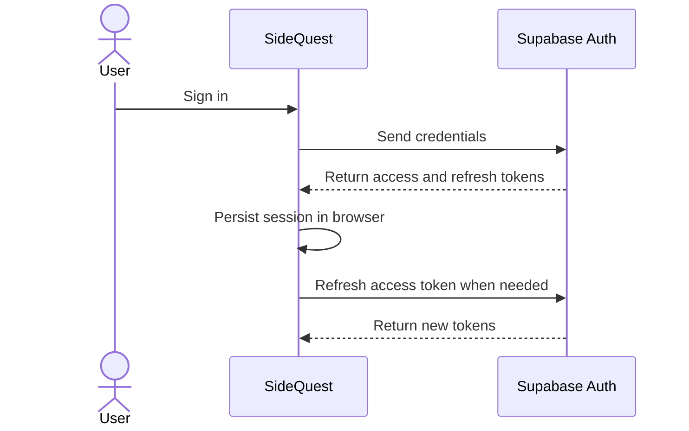

# TE6: Authentication and Access Tokens

SideQuest uses Supabase Auth to authenticate users and manage
sessions.

## How it works

1. A user signs in with their credentials.
2. Supabase returns an access token and a refresh token.
3. The session is stored in the browser so the user can remain
   signed in.
4. The access token expires after 3,600 seconds (one hour).
5. Supabase can use the refresh token to obtain a new access
   token.
6. If the session ends or the refresh token can no longer be
   used, the user must sign in again.

The access token does not last forever, but its expiration does
not automatically sign the user out. Currently, no overall
session time limit or inactivity timeout is configured.

## Authentication sequence

